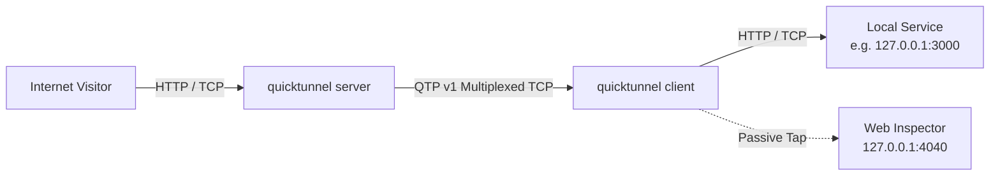

# QuickTunnel

Fast, secure HTTP and TCP reverse tunnels to localhost with an embedded Web Inspector, written in Rust.

QuickTunnel establishes high-performance tunnels that expose local servers (development web apps, webhooks, databases, SSH) to the internet or private networks through a single multiplexed TCP connection. It includes a built-in dark-mode Web Inspector at `http://127.0.0.1:4040` with real-time request streaming and one-click request replay.

---

## Features

- **Custom QTP v1 Protocol**: Binary wire framing over a single TCP stream with credit-based flow control and priority scheduling.
- **HTTP/1.1 Subdomain Routing**: Dynamic subdomain allocation (`mysite.tunnel.example.com`) with virtual host mapping.
- **Raw TCP Port Forwarding**: Transparent proxying for non-HTTP services (PostgreSQL, Redis, SSH, game servers).
- **Embedded Web Inspector**: Responsive, zero-dependency dark-mode dashboard at `http://127.0.0.1:4040` embedded directly into the binary (`include_str!`).
- **Real-Time Request Streaming**: Server-Sent Events (SSE) live updates in the browser and terminal access logging (`pretty` or `json`).
- **One-Click Replay Engine**: Re-executes captured HTTP requests against local targets with automatic hop-by-hop header stripping and `Content-Length` recalculation.
- **DNS Rebinding Defense**: Loopback verification on the inspector prevents malicious web pages from accessing local tunnel traffic.
- **HMAC-SHA256 Authentication**: Challenge-response handshake with nonce exchange, timestamp freshness checks, and replay attack prevention.
- **Resilient Reconnection Loop**: Exponential backoff with decorrelated jitter recovers from network drops while immediately aborting on fatal errors.
- **High Test Quality**: Over 95% workspace test coverage with 0 compiler and Clippy warnings.

---

## Architecture



### Workspace Crates

| Crate | Path | Description |
|---|---|---|
| [`qt-proto`](crates/qt-proto) | `crates/qt-proto` | Binary wire framing, QTP v1 state machine, TLVs, and CRC32 verification. |
| [`qt-mux`](crates/qt-mux) | `crates/qt-mux` | Stream multiplexer with credit-based flow control and stream scheduling. |
| [`qt-server`](crates/qt-server) | `crates/qt-server` | Control listener, HMAC authenticator, HTTP reverse proxy, and dynamic TCP proxy. |
| [`qt-client`](crates/qt-client) | `crates/qt-client` | Client daemon, reconnect backoff, Host header rewriter, and local forwarder. |
| [`qt-inspector-ui`](crates/qt-inspector-ui) | `crates/qt-inspector-ui` | In-memory ring buffer, passive tap, embedded HTML/JS dashboard, and replay engine. |
| [`quicktunnel`](crates/quicktunnel) | `crates/quicktunnel` | Production CLI binary (`server`, `client`, `genkey`). |

---

## Installation & Building

### Prerequisites

- [Rust](https://rustup.rs/) 1.75 or newer

### Build from Source

```bash
git clone https://github.com/quicktunnel/quicktunnel.git
cd quicktunnel
cargo build --release
```

The compiled binary will be located at `target/release/quicktunnel`.

You can optionally install it into your `~/.cargo/bin` path:

```bash
cargo install --path crates/quicktunnel
```

---

## Quick Start (5 Minutes)

### 1. Generate an Authentication Secret

Generate a cryptographically secure 256-bit token:

```bash
quicktunnel genkey
```

*Output:*
```text
3f8a4e8d2c91b5a76e0f1d3c8b7a6e5f4d3c2b1a0f9e8d7c6b5a4f3e2d1c0b9a
```

### 2. Start the Server Daemon

Run the server on your public host or locally for testing:

```bash
quicktunnel server \
  --control-bind 0.0.0.0:7000 \
  --http-bind 0.0.0.0:80 \
  --domain tunnel.local \
  --secret 3f8a4e8d2c91b5a76e0f1d3c8b7a6e5f4d3c2b1a0f9e8d7c6b5a4f3e2d1c0b9a
```

> **Tip:** You can also supply the secret via the `QT_SECRET` environment variable.

### 3. Start a Local Web Application

In another terminal, start your local web application (for example, on port 3000):

```bash
python3 -m http.server 3000
```

### 4. Connect the Client Tunnel

Start the client tunnel to expose your local application:

```bash
quicktunnel client \
  --to 127.0.0.1:7000 \
  --local 3000 \
  --secret 3f8a4e8d2c91b5a76e0f1d3c8b7a6e5f4d3c2b1a0f9e8d7c6b5a4f3e2d1c0b9a
```

*Terminal banner:*
```text
┌────────────────────────────────────────────────────────┐
│  QuickTunnel Client                                   │
│  Status:     Online                                    │
│  Forwarding: http://a1b2c3d4.tunnel.local -> 127.0.0.1:3000
│  Inspector:  http://127.0.0.1:4040                    │
└────────────────────────────────────────────────────────┘
```

### 5. Inspect and Replay Traffic

Open `http://127.0.0.1:4040` in your web browser. You will see:
- Live incoming requests streaming via Server-Sent Events (SSE).
- Request & Response header tables and body viewer.
- "Copy as cURL" button.
- "Replay" button to resend requests directly to your local service.

---

## CLI Reference

### `quicktunnel genkey`

Generates a 32-byte cryptographically secure random secret and prints a 64-character hexadecimal string.

```bash
quicktunnel genkey
```

---

### `quicktunnel server`

Starts the QuickTunnel server daemon.

```bash
quicktunnel server [OPTIONS] --secret <SECRET>
```

| Flag | Environment Variable | Default | Description |
|---|---|---|---|
| `--control-bind <ADDR>` | - | `0.0.0.0:7000` | Address for QTP client control connections. |
| `--http-bind <ADDR>` | - | `0.0.0.0:80` | Public address for incoming HTTP visitor traffic. |
| `--domain <DOMAIN>` | - | `tunnel.local` | Base root domain for virtual host subdomains. |
| `--tcp-port-range <RANGE>` | - | `20000-29999` | Port range for dynamic TCP tunnel allocations. |
| `--secret <SECRET>` | `QT_SECRET` | *(Required)* | HMAC-SHA256 authentication secret. |

---

### `quicktunnel client`

Starts the QuickTunnel client tunnel and optional Web Inspector.

```bash
quicktunnel client [OPTIONS] --local <LOCAL> --secret <SECRET>
```

| Flag | Environment Variable | Default | Description |
|---|---|---|---|
| `--local <TARGET>` | - | *(Required)* | Local target port (`3000`) or address (`127.0.0.1:3000`, `http://localhost:3000`). |
| `--to <ADDR>` | - | `127.0.0.1:7000` | Server control address (`host:port`). |
| `--secret <SECRET>` | `QT_SECRET` | *(Required)* | HMAC-SHA256 authentication secret. |
| `--mode <MODE>` | - | `http` | Tunnel mode: `http` or `tcp`. |
| `--subdomain <NAME>` | - | *(Random)* | Request a specific subdomain (e.g. `myapp`). |
| `--remote-port <PORT>` | - | *(Random)* | Request a specific remote port in TCP mode. |
| `--host-header <POLICY>` | - | `rewrite` | Host header policy: `rewrite`, `preserve`, or `custom:<host>`. |
| `--inspect-port <PORT>` | - | `4040` | Port for the embedded Web Inspector UI. |
| `--no-inspect` | - | `false` | Disable the Web Inspector server and tap. |
| `--log <FORMAT>` | - | `pretty` | Terminal access log format: `pretty` or `json`. |

---

## Common Use Cases

### Request a Specific Subdomain

Expose your application on `http://api.tunnel.local`:

```bash
quicktunnel client --local 8000 --subdomain api
```

### Preserving or Customizing HTTP Host Headers

Frameworks like Vite, Next.js, or Webpack Dev Server often validate the HTTP `Host` header. QuickTunnel gives you full control:

- **Rewrite to target (default)**: Rewrites `Host` to match your local target (e.g. `127.0.0.1:3000`).
  ```bash
  quicktunnel client --local 3000 --host-header rewrite
  ```

- **Preserve original public Host**: Passes the public visitor Host header (e.g. `api.tunnel.local`) unchanged.
  ```bash
  quicktunnel client --local 3000 --host-header preserve
  ```

- **Custom Host**: Injects a custom hostname for services expecting a specific domain:
  ```bash
  quicktunnel client --local 3000 --host-header custom:dev.internal.net
  ```

### Raw TCP Tunneling (Databases, SSH)

Expose a local PostgreSQL database or SSH server over a dedicated public TCP port:

```bash
quicktunnel client \
  --mode tcp \
  --local 5432 \
  --remote-port 25432
```

*Output:*
```text
┌────────────────────────────────────────────────────────┐
│  QuickTunnel Client                                   │
│  Status:     Online                                    │
│  Forwarding: tcp:25432 -> 127.0.0.1:5432              │
└────────────────────────────────────────────────────────┘
```

Now connect to your database from anywhere:
```bash
psql -h tunnel.example.com -p 25432 -U postgres
```

### Headless / CI / Docker Deployment

Run without the Web Inspector and stream structured JSON logs to stdout:

```bash
export QT_SECRET="your-256-bit-hex-secret"
quicktunnel client \
  --to tunnel.example.com:7000 \
  --local 8080 \
  --no-inspect \
  --log json
```

*Example JSON log output:*
```json
{"id":"01JARB1Z92F1K7C919A4B8","method":"GET","path":"/health","status":200,"duration_ms":12}
```

---

## Web Inspector & REST API

When running in HTTP mode (default), QuickTunnel provides an inspection server at `http://127.0.0.1:4040`.

### Endpoints

| Method | Endpoint | Description |
|---|---|---|
| `GET` | `/` | Web dashboard single-page application. |
| `GET` | `/api/requests` | List captured requests (up to 100 recent entries). |
| `GET` | `/api/requests/:id` | Full details for a single request (headers, body, timings). |
| `GET` | `/api/metrics` | Aggregate stats: total requests, 2xx/3xx/4xx/5xx counts, average latency, bytes transferred. |
| `GET` | `/events` | Server-Sent Events (SSE) live transaction stream. |
| `POST` | `/api/replay/:id` | Re-executes the captured request against the local target service and records response. |

### DNS Rebinding Protection

To prevent malicious websites from exploiting localhost endpoints, the Web Inspector validates the `Host` header on all requests. Any request with a `Host` header other than `localhost`, `127.0.0.1`, or `[::1]` is rejected with `403 Forbidden: Invalid Host`. Additionally, cross-origin access (`Access-Control-Allow-Origin: *`) is denied.

---

## Security Model

1. **Authentication**: All client connections authenticate via an HMAC-SHA256 handshake challenge with mutual nonce exchange and timestamp freshness checks. Unauthenticated streams are rejected immediately.
2. **Denial-of-Service Defense**:
   - Header sizes are capped at 8–16 KiB with strict timeout limits (3s slowloris guard).
   - In-memory ring buffer enforces a 64 MiB payload cap and 1,000 transaction ceiling, evicting oldest entries automatically.
   - Passive HTTP tap uses non-blocking bounded channels (`try_send`) ensuring visitor traffic forwarding is never stalled or blocked.
3. **Privilege Separation**: The server can run as an unprivileged user. If binding to privileged ports (80/443), standard Linux capabilities (`setcap 'cap_net_bind_service=+ep'`) can be used.

---

## Development & Verification

### Running the Test Suite

Run all unit, integration, and doc tests across the entire workspace:

```bash
cargo test --workspace
```

### Code Coverage

Measure code coverage with `cargo-llvm-cov`:

```bash
cargo llvm-cov --workspace --summary-only
```

*Current Coverage:*
- **Regions**: 94.84% (19,394 / 20,450)
- **Lines**: 95.69% (11,308 / 11,821)
- **Functions**: 95.98% (1,121 / 1,168)

### Linters and Formatting

```bash
cargo clippy --workspace --all-targets -- -D warnings
cargo fmt --check
```

---

## License

QuickTunnel is dual-licensed under either:

- [MIT License](LICENSE-MIT)
- [Apache License, Version 2.0](LICENSE-APACHE)

at your option.
